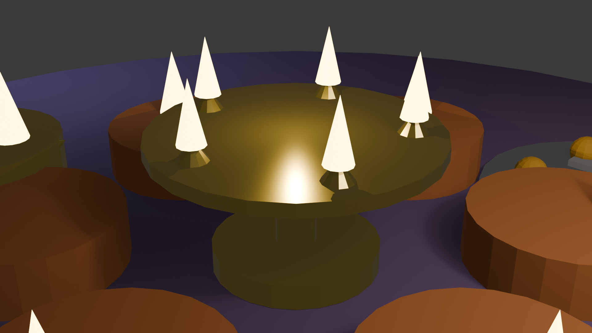

# 🪔 Shubh Deepavali 3D — Real Celebrations & 3D Interactive Hub ✨

> **Live Demo on GitHub Pages**: [https://WebDevWithPritom.github.io/diwali-celebration-3d/](https://WebDevWithPritom.github.io/diwali-celebration-3d/)

An ultra-bright, 60 FPS interactive 3D Diwali celebration built with **Three.js**, **Blender 3D Procedural Integration**, **Real Authentic Audios**, and **Actual HD Festive Videos**!



---

## 🌟 Features & Highlights

### 1. 🪔 Fully Interactive 3D Courtyard & Sacred Ghats
* **Clay Diyas & Central Brass Aarti Diya**: Click on any unlit diya to kindle its sacred golden flame with animated flicker and real-time point lights.
* **Pavana Sarovar**: Sacred water body with moving turquoise wave ripples. Release gently bobbing and drifting **Floating Lotus Diyas** into the river current!
* **Panch-Pradip Maha Aarti Ceremony**: Click "Perform Maha Aarti" to elevate the brass thali in a circular sacred offering path while playing **real Temple Aarti chanting and the divine Shankha (Conch)**!
* **Laser Deepotsav Show**: Multi-beam architectural laser sweeps illuminating the festive night sky.

### 2. 🪄 3D Handheld Sparkler (Phuljhadi) & Light Painting
* Move your cursor / touch in 3D air to paint with **glowing golden light ribbons** accompanied by sizzling sparkler sounds.

### 3. 🎆 3D Green Eco-Friendly Crackers
* **Whistling Sky Rockets**: Click anywhere in the 3D sky to launch rockets that burst into multi-color spherical particle fireworks.
* **Golden Anar**: Place conical fountains on the courtyard terrace that erupt into towering sparks.
* **Ground Chakri**: Place spinning discs throwing whirling rings of sparks.
* **Wish Lanterns (Kandils)**: Write your own prayer and release your luminous lantern towards the heavens. Click any floating lantern in the sky to read its blessing!
* **Grand Finale**: A synchronized 14-rocket aerial show with multi-color bursts.

### 4. 🎨 Blender 3D Integration & Procedural Scene
* Procedurally modeled in **Blender 5.2.2 LTS** using Python (`blender/create_diwali_3d.py`).
* Includes:
  * [`blender/diwali_celebration.blend`](blender/diwali_celebration.blend) — Native editable Blender project.
  * [`blender/diwali_scene.glb`](blender/diwali_scene.glb) — Universal 3D glTF model rendered directly in WebGL.
  * [`blender/diwali_render.png`](blender/diwali_render.png) — 1080p cinematic studio render.
  * Multi-tier brass Panch-Pradip lamp, blooming lotus diya, and silver thaali of **Kaju Katli** & **Motichoor Laddoos**.

### 5. 🎶 100% Royalty-Free & Stream-Safe Audios
* 🪔 **Real Temple Aarti Puja**: Authentic devotional recording of traditional Aarti with temple bells (CC0 Public Domain).
* 🎶 **Real Divine Bansuri Flute**: Soothing classical bamboo flute raga (CC-BY-SA).
* 🪕 **Real Classical Sitar**: Auspicious festive sitar melody (CC-BY-SA).
* **Live Web Audio Synthesizer**: Math-synthesized acoustic cracker explosions and sparkler sizzles with zero Content ID fingerprint.

### 6. 🎬 Real Video Cinema Player
* Click **"🎬 Real Videos"** in the top bar to watch actual real footage of:
  * 🎆 **Real Sky Fireworks Display**
  * 🪔 **Real Diwali Ground Crackers & Sparks**
  * 🌋 **Real Golden Phuljhadi & Flowerpots**

### 7. 📺 Streamer & OBS Mode
* Press **`H`** or click **OBS Mode** for a clean, HUD-free cinematic view suitable for live streams.
* Hotkeys:
  * **`H`**: Toggle clean view
  * **`Space`**: Grand Fireworks Finale
  * **`A`**: Perform Maha Aarti
  * **`L`**: Toggle Laser Deepotsav Show
  * **`F`**: Toggle Fullscreen

### 8. 📸 Postcard Studio
* Capture your custom 3D festive view with personalized greeting text and download as a high-res greeting card image!

---

## 🚀 Running Locally

```bash
# Clone the repository
git clone https://github.com/WebDevWithPritom/diwali-celebration-3d.git
cd diwali-celebration-3d

# Install dependencies
npm install

# Start Vite dev server
npm run dev

# Build production bundle
npm run build
```

---

*Wishing you and your loved ones a sparkling, joyous, and blessed Diwali!* 🪔✨
